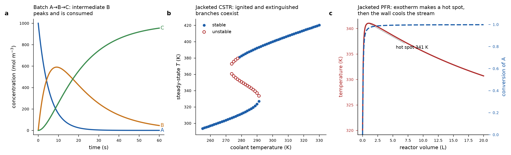

# reactor-api

[](https://github.com/kraewon7422/reactor-api/actions/workflows/ci.yml)
[](pyproject.toml)
[](LICENSE)

An ideal-reactor solver for arbitrary reaction networks, exposed as a FastAPI
web service and usable as a plain Python library. The chemistry is part of the
request body, so new kinetics need no code changes.

* **Reactors**: constant-volume batch, CSTR (steady state with multiplicity
  detection, or transient), and plug-flow (liquid, or ideal gas with mole change).
* **Chemistry**: any number of species and reactions, signed stoichiometry,
  mass-action or user-supplied orders, optional reversibility, modified-Arrhenius
  rate constants.
* **Energy**: isothermal, adiabatic, or jacketed, with a volumetric or
  per-species heat capacity.



*(a) Isothermal batch A→B→C. (b) Steady states of a jacketed exothermic CSTR
plotted against coolant temperature. There is an S-shaped multiplicity window,
and a few ignited-branch states just past ignition are flagged unstable, which
matches an oscillatory instability near the turning point. (c) Jacketed PFR
hot spot. Every case is a request body served from `/examples`.*

## Quick start

```bash
pip install "git+https://github.com/kraewon7422/reactor-api.git"
reactor-api --port 8000          # or: python -m reactor_api
```

Open <http://127.0.0.1:8000/docs> for interactive Swagger docs. The schema is
served at `/openapi.json`.

```bash
curl -s localhost:8000/examples \
  | jq '."/simulate/cstr/steady".exothermic_multiplicity' \
  | curl -s localhost:8000/simulate/cstr/steady -H 'content-type: application/json' -d @- \
  | jq '.solutions[] | {T, conversion, stable}'
```

### Docker

```bash
docker build -t reactor-api .
docker run -p 8000:8000 reactor-api
```

### As a library

```python
from reactor_api import Reaction, Thermal, build_network, simulate_pfr

net = build_network(None, [Reaction({"A": -1, "B": 2}, A=0.5)])
out = simulate_pfr(
    net, Thermal(), net.vector({"A": 40.0}), T_in=500.0, V=0.2, Q=0.01, phase="gas", key_species="A"
)
print(out["outlet"]["conversion"])  # 0.9959
```

## Development

```bash
git clone https://github.com/kraewon7422/reactor-api.git
cd reactor-api
pip install -e ".[dev]"
pytest -q                        # analytic verification suite
ruff check . && ruff format --check .
python examples/client_demo.py   # runs the app in-process, no server needed
```

CI runs lint, then tests on Python 3.10 to 3.13 (Ubuntu) and 3.12 (Windows and
macOS), then builds the Docker image and checks `/health`.

### Layout

```
reactor_api/
  kinetics.py    stoichiometry matrix, Arrhenius rates, heat release
  reactors.py    batch / CSTR / PFR balances and solvers
  schemas.py     pydantic request and response models
  app.py         FastAPI routes and error mapping
  examples.py    request bodies served from /examples
  __main__.py    `reactor-api` CLI
tests/           verification against closed-form solutions + HTTP tests
examples/        client demo (HTTP or in-process)
docs/            figure
```

## Endpoints

| Method | Path | Purpose |
|---|---|---|
| GET  | `/health` | liveness probe |
| GET  | `/examples` | ready-to-POST request bodies for every route |
| POST | `/simulate/batch` | constant-volume batch, time series |
| POST | `/simulate/cstr/steady` | all steady states + stability |
| POST | `/simulate/cstr/transient` | start-up / dynamic response |
| POST | `/simulate/cstr` | dispatches on the body's `mode` field |
| POST | `/simulate/pfr` | steady-state axial profiles |

Bad chemistry, a missing heat capacity, or an unsolvable steady state come back
as **422** with a readable `detail`; nothing in the request can produce a 500.

## Units

Strict SI, no exceptions: concentration `mol/m³`, volume `m³`, flow `m³/s`,
time `s`, temperature `K`, `Ea` and `dH` in `J/mol` (negative `dH` is
exothermic), `rho_cp` in `J/(m³·K)`, `cp_molar` in `J/(mol·K)`, `UA` in `W/K`,
pressure `Pa`. The pre-exponential `A` carries whatever units the overall
reaction order requires.

## Request body

```jsonc
{
  "reactions": [
    { "name": "A->B",
      "stoichiometry": {"A": -1, "B": 1},   // negative = reactant
      "A": 1.2e9, "Ea": 72747.0,            // k = A (T/T_ref)^b exp(-Ea/RT)
      "b": 0.0, "T_ref": 298.15,
      "orders": {"A": 1.0},                 // optional; default = mass action
      "A_rev": null, "Ea_rev": 0.0,         // set A_rev for a reversible step
      "dH": -50000.0 }
  ],
  "thermal": { "mode": "jacketed",          // isothermal | adiabatic | jacketed
               "rho_cp": 2.39e5,            // or "cp_molar": {"A": 150, "B": 150}
               "UA": 600.0, "T_coolant": 280.0 },
  "C_in": {"A": 1000.0, "B": 0.0},
  "T_in": 350.0, "V": 0.1, "Q": 1.6667e-3,
  "mode": "steady", "key_species": "A",
  "T_scan": [280.0, 500.0], "n_points": 200
}
```

Batch uses `C0`/`T0`/`t_end` instead of `C_in`/`T_in`/`V`/`Q`; the CSTR accepts
`tau` in place of `Q`; the PFR adds `phase` (`liquid` | `gas`) and `P`.
Species are inferred from the stoichiometry and the feed unless `species` is
given explicitly, so inerts and solvents can be carried just by listing them in
the feed. Unknown fields are rejected rather than silently ignored.


## Model

With `nu` the signed stoichiometric matrix and `r_j` the net rate of reaction
`j` (`mol m⁻³ s⁻¹`), heat capacity per unit volume `cv` (`rho_cp`, or
`sum_i C_i cp_i` when `cp_molar` is given), and `ua = UA/V`:

| Reactor | Material | Energy |
|---|---|---|
| Batch | `dC_i/dt = sum_j nu_ij r_j` | `cv dT/dt = sum_j (-dH_j) r_j - ua (T - T_c)` |
| CSTR | `dC_i/dt = (C_i,in - C_i)/tau + sum_j nu_ij r_j` | `cv dT/dt = cv_in (T_in - T)/tau + sum_j (-dH_j) r_j - ua (T - T_c)` |
| PFR | `dF_i/dV = sum_j nu_ij r_j` | `Q cv dT/dV = sum_j (-dH_j) r_j - ua (T - T_c)` |

Transients and axial profiles are integrated with `scipy.integrate.solve_ivp`
(LSODA, `rtol=1e-8`, `atol=1e-10` by default, both settable per request). CSTR
steady states come from `scipy.optimize.root` on the scaled residuals, started
from a grid of temperature guesses (`T_scan`, `n_guesses`) so that all branches
of a multiplicity window are found; each solution is classified stable or
unstable from the eigenvalues of the dynamic Jacobian, and
`max_eigenvalue_real` is returned alongside. For `phase: "gas"` the volumetric
flow follows the ideal-gas law at constant pressure, so mole change and heating
expand the stream.

## Verification

`tests/test_reactor_api.py` (31 tests) checks the engine against closed-form
solutions rather than reference outputs:

* first-order, second-order and reversible batch decay against their analytic
  concentration profiles, and the analytic equilibrium composition;
* adiabatic batch against the exact energy balance `cv (T - T0) = (-dH) xi`,
  and `cp_molar` against an equivalent `rho_cp`;
* jacketed cooling against Newtonian relaxation with no reaction;
* CSTR steady state against `C = C_in/(1 + k tau)`, and the adiabatic energy
  balance line;
* the classic exothermic CSTR: three steady states, stable–unstable–stable,
  with the transient from a cold start converging onto a stable branch;
* PFR against `C = C_in exp(-k tau)`, against the batch solution at equal
  residence time, and — for gas-phase `A -> 2B` — against the analytic
  `-X - 2 ln(1 - X) = k tau` with the ideal-gas bookkeeping `P = R T sum(C)`;
* every documented example payload over HTTP, the `mode` dispatch, and five
  classes of invalid request returning 422.

## Scope

Ideal reactors only: perfect mixing in the CSTR, no axial dispersion or radial
gradients in the PFR, constant reactor volume in batch mode. Pressure drop
(Ergun) and intraparticle diffusion for packed beds are not modelled, the gas
phase is isobaric and ideal, and `dH` and `cp` are taken as
temperature-independent. Adding a `dP/dV` term and an effectiveness factor is
the natural next extension of `reactor_api/reactors.py`.

## License

Licensed under the [Apache License 2.0](LICENSE).
